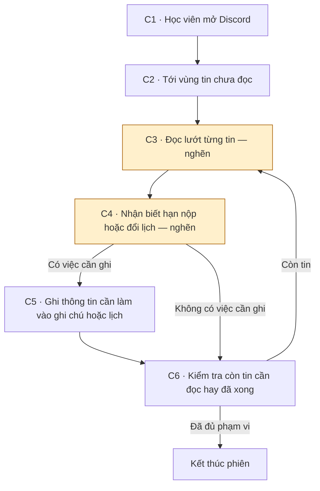
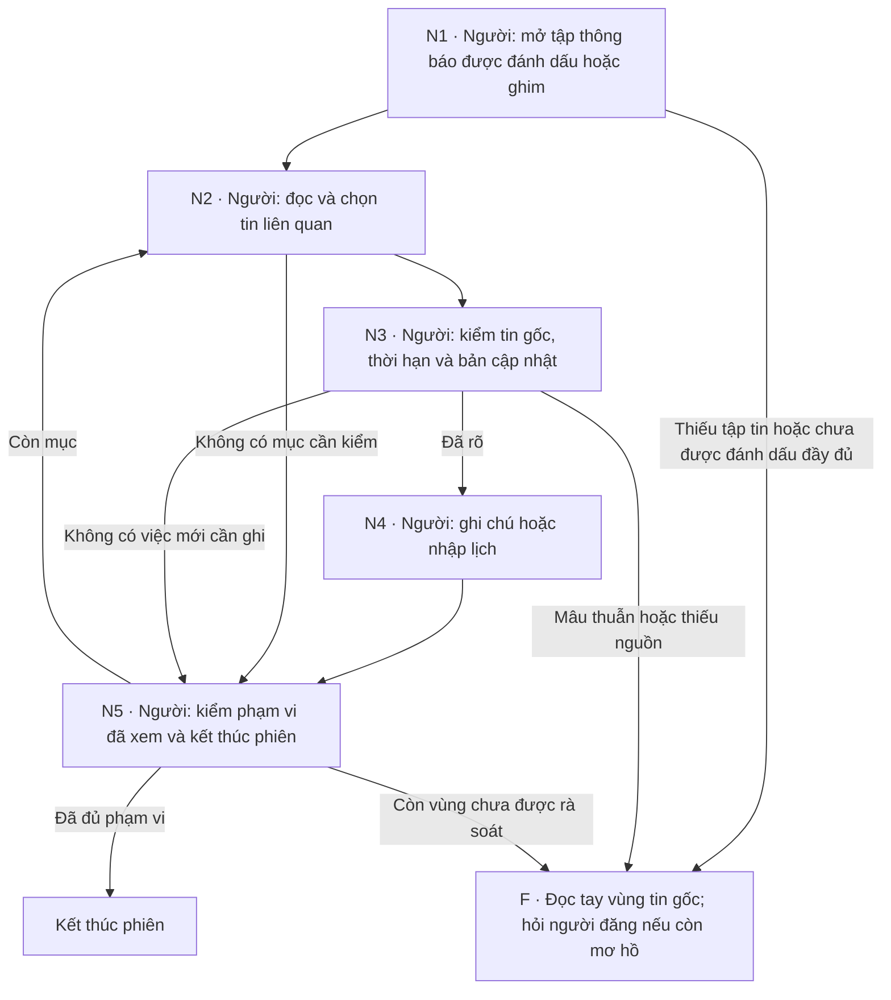
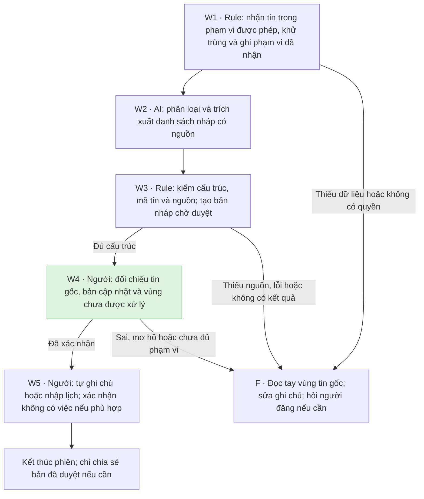

# Báo cáo nhóm — Day 02 Discovery & Problem Framing

> Bản chung của nhóm, viết trên repo do nhóm trưởng fork. Không copy file này sang repo cá nhân.
> Template chi tiết và prompt mẫu: [docs/01-worksheet.md](../../docs/01-worksheet.md). Bài mẫu: [docs/02-deliverable-example.md](../../docs/02-deliverable-example.md).

## 1. Thông tin nhóm

- Tên nhóm: PhungTruongThanh
- Thành viên: xem `TEAM.md`
- Candidate problem được chọn (1 câu): Khó tìm và nhận biết các thông báo quan trọng (hạn nộp bài, đổi lịch) bị trôi trong kênh Discord học tập (Candidate B1).
- Quyết định cuối: Not Yet (Cần phỏng vấn thực tế ngoài nhóm và thử nghiệm quy ước No AI trước)

---

## 2. Hội tụ nhóm (CP3)

### 2.1. Pitch

| # | Người đưa ra | Candidate (Job Story ngắn) | Actor | Bottleneck | Câu hỏi phản biện nhận được (ai hỏi) |
|---:|---|---|---|---|---|
| A1 | Phụng | **Báo lỗi thiếu thông tin:** Khi nhận thông báo “máy bị lỗi”, tôi muốn có đủ thông tin về triệu chứng ngay từ đầu, để xác định cách xử lý nhanh hơn. | Nhân viên IT | Hỏi lại 2–3 lượt để lấy đủ mô tả và ảnh lỗi | "Nếu bắt điền biểu mẫu nhiều trường thì người dùng có lười rồi vẫn nhắn tin tự do không?" (Trường hỏi) |
| A2 | Phụng | **Yêu cầu hỗ trợ nằm rải rác:** Khi nhận yêu cầu hỗ trợ qua nhiều kênh, tôi muốn biết những việc nào còn chưa xử lý, để không bỏ sót yêu cầu. | Nhân viên IT | Đối chiếu trạng thái yêu cầu giữa nhiều kênh rời rạc | "Có thể quy định công ty chỉ dùng 1 kênh duy nhất không, tại sao phải gom nhiều kênh?" (Thanh hỏi) |
| A3 | Phụng | **Tìm và soạn lại hướng dẫn lỗi thường gặp:** Khi nhân viên hỏi cách xử lý một lỗi thường gặp, tôi muốn tìm nhanh hướng dẫn phù hợp, để hỗ trợ họ mà không phải soạn lại từ đầu. | Nhân viên IT | Tìm kiếm hướng dẫn cũ nằm rải rác | "Làm một trang FAQ/Wiki có giải quyết được không nếu người dùng vẫn ngại đọc bài dài?" (Trường hỏi) |
| B1 | Trường | **Khó tìm thông báo quan trọng trong Discord:** Khi kênh chat quá nhiều tin thảo luận, tôi muốn lọc nhanh các thông báo bài tập/lịch học quan trọng, để không bị trôi tin và lỡ hạn. | Học viên | Đọc lướt nhiều tin nhắn để nhận ra hạn nộp, đổi lịch | "Discord đã có tính năng ghim tin nhắn (Pinned) và kênh `#announcement`, tại sao vẫn bị trôi?" (Phụng hỏi) |
| B2 | Trường | **Chép deadline vào lịch cá nhân:** Khi có deadline mới công bố trên lớp, tôi muốn đưa nhanh vào lịch cá nhân, để nhận thông báo nhắc nhở tự động đúng hạn. | Học viên | Xác định giờ nộp và nhập lịch thủ công từng môn | "Một tuần có bao nhiêu deadline để việc nhập tay này trở thành vấn đề nghiêm trọng?" (Thanh hỏi) |
| B3 | Trường | **Conflict khi cùng sửa báo cáo:** Khi cả nhóm cùng viết báo cáo bài tập lớn, tôi muốn đồng bộ nội dung đang làm, để không bị ghi đè hoặc xung đột code/text. | Nhóm làm lab | Giải quyết xung đột nội dung khi ghép bài | "Nếu dùng Google Docs hoặc chia file Markdown riêng theo từng mục thì có còn bị conflict không?" (Phụng hỏi) |
| C1 | Thanh | **Khó chọn nội dung ưu tiên ôn từ nhiều PDF:** Khi chuẩn bị thi cuối kỳ từ hàng chục slide và tài liệu, tôi muốn biết các phần trọng tâm cần học, để ôn tập hiệu quả mà không lan man. | Sinh viên | Đọc và chọn lọc nội dung trọng tâm từ nhiều tài liệu | "Trọng tâm bài thi phụ thuộc vào đề giảng viên ra, làm sao công cụ biết được phần nào chắc chắn thi?" (Trường hỏi) |
| C2 | Thanh | **Điểm danh đầu giờ mất thời gian:** Khi bắt đầu buổi học/lab, tôi muốn ghi nhận sự có mặt nhanh chóng, để bắt đầu bài học đúng giờ mà không tốn thời gian gọi tên. | Giảng viên, sinh viên | Gọi tên và đọc lại danh sách từng người | "Trường hoặc lớp đã có mã QR quét điểm danh chưa, rào cản ở đây là công nghệ hay thói quen?" (Phụng hỏi) |
| C3 | Thanh | **Phải hướng dẫn lại thao tác điện thoại cho bố mẹ:** Khi bố mẹ gặp khó khi dùng smartphone, tôi muốn có cách hướng dẫn trực quan từ xa, để bố mẹ tự làm được mà không phải hỏi lại cùng một việc. | Bố mẹ, người hướng dẫn | Nhắc lại các thao tác nhiều lần vì người lớn tuổi chưa nhớ | "Vấn đề này quá phụ thuộc vào khả năng tiếp thu công nghệ của người lớn tuổi, liệu giải pháp số có khả thi?" (Trường hỏi) |

### 2.2. Cluster

| Cluster | Các candidate | Pattern chung |
|---|---|---|
| A — Tìm và chọn thông tin cần thiết | A3, B1, C1 | Phải đọc hoặc tìm kiếm qua nhiều nội dung rời rạc để lấy đúng phần thông tin phù hợp |
| B — Tiếp nhận và theo dõi yêu cầu | A1, A2 | Thiếu thông tin ban đầu hoặc thiếu trạng thái minh bạch để xử lý và bàn giao công việc |
| C — Công việc hành chính lặp lại | B2, C2 | Các thao tác thủ công, lặp đi lặp lại định kỳ có quy trình từng bước tương đối rõ ràng |
| D — Phối hợp sửa tài liệu | B3 | Nhiều người cùng thao tác và thay đổi trên một tài liệu/báo cáo dẫn đến xung đột nội dung |
| E — Hướng dẫn thao tác và ghi nhớ | C3 | Người dùng khó nhớ các bước thao tác kỹ thuật và cần người khác hướng dẫn/nhắc lại nhiều lần |

### 2.3. Opportunity Solution Tree rút gọn

Gốc là **1 outcome**. Nhánh là **opportunity** (nhu cầu, pain), không phải tính năng hay công cụ.

```text
OUTCOME: Giảm thời gian học viên tìm kiếm và nhận biết các thông báo quan trọng (hạn nộp, đổi lịch) trên Discord từ 15 phút/ngày xuống dưới 3 phút/ngày
├── Opportunity 1: Thông báo bài tập và đổi lịch bị trôi lẫn trong hàng trăm tin nhắn thảo luận hằng ngày trong các kênh chat chung
├── Opportunity 2: Tính năng ghim tin (Pinned Messages) không được dọn dẹp thường xuyên, lẫn lộn giữa thông báo cũ đã hết hạn và thông báo mới
└── Opportunity 3: Từ khóa tìm kiếm không đồng nhất giữa các môn/mentor, khiến việc dùng Discord Search khó ra đúng thông báo mới nhất
```

Những ý đã gạch bỏ vì là solution đội lốt opportunity:

- ✗ *"Xây dựng bot Discord AI tự động tóm tắt tin nhắn"* ← Solution đội lốt opportunity (nhu cầu gốc là lọc nhận biết thông báo quan trọng, bot chỉ là một công cụ khả dĩ).
- ✗ *"Tạo kênh #announcement riêng và ping @everyone bắt buộc"* ← Solution đội lốt opportunity (đây là cách tổ chức kênh/quy định, chưa giải quyết được việc người dùng bị bội thực thông báo).
- ✗ *"Dùng chatbot hỏi đáp tự động trên Discord"* ← Solution đội lốt opportunity.

### 2.4. Chấm điểm shortlist (1–5)

| Candidate | Actor rõ | Quy trình rõ | Pain có bằng chứng | Impact đo được | Vừa sức lab | So sánh được No AI/Rule/Workflow/Agent | Nhóm hiểu domain | Tổng |
|---|---:|---:|---:|---:|---:|---:|---:|---:|
| B1 — Trường: Tìm thông báo quan trọng trên Discord | 5 | 5 | 3 | 4 | 5 | 5 | 4 | **31/35** |
| C1 — Thanh: Chọn nội dung ưu tiên ôn từ nhiều PDF | 5 | 4 | 3 | 3 | 3 | 4 | 4 | **26/35** |
| A1 — Phụng: Yêu cầu báo lỗi thiếu thông tin | 4 | 4 | 1 | 4 | 4 | 4 | 3 | **24/35** |

**Candidate được chọn:** B1 — Tìm thông báo quan trọng trên Discord (của Trường).

**Vì sao chọn:**
- Đạt điểm cao nhất (31/35) trên 7 tiêu chí.
- Quy trình cụ thể, phạm vi nhỏ, vừa sức giải quyết trong một buổi lab.
- Rất dễ tiếp cận đối tượng học viên ngay tại lớp để phỏng vấn kiểm chứng và đo lường tác động thực tế (nhóm chọn B1 vì bài toán rõ ràng, dễ đo lường chứ không phải vì có thể dùng AI).
- So sánh được rõ ràng giữa các mức can thiệp: No AI (kênh riêng/ghim tin), Rule (bot lọc keyword), Workflow và Agent.

**Vì sao loại các candidate còn lại:**
- **Loại C1 (Chọn nội dung ưu tiên ôn từ nhiều PDF — 26/35):** Trải nghiệm cá nhân rõ nhưng thời gian đọc/chọn chỉ là ước lượng; rất khó kiểm chứng ngay trong một buổi lab rằng việc rút ngắn thời gian chọn tài liệu vẫn đảm bảo chất lượng ôn thi.
- **Loại A1 (Yêu cầu báo lỗi thiếu thông tin — 24/35):** Dù có thể đo số lượt hỏi lại và thời gian tiếp nhận, nhưng hiện chưa có tình huống thật hay số liệu đo lường trực tiếp tại lớp; đối tượng nhân viên IT và người dùng nội bộ khó tiếp cận để kiểm chứng ngay trong buổi lab hơn so với học viên.

**Xử lý bất đồng (nếu có):**
- Điểm “nhóm hiểu domain” ở cả 3 dòng hiện là ước tính ban đầu của nhóm, cần được điều chỉnh lại sau khi kiểm chứng thực tế với người dùng.
- Nhóm thống nhất: B1 có bằng chứng mới ở mức mô tả trong báo cáo (thời gian 15 phút/ngày chưa đo thực tế, chưa thể coi cả lớp đều gặp vấn đề). Nhóm quyết định đưa giả định này vào CP4 để phỏng vấn/khảo sát các bạn học viên khác trong lớp nhằm xác thực mức độ đau thật sự trước khi bước vào thiết kế giải pháp.

---

## 3. Kiểm chứng + research giải pháp đã có (CP4)

### 3.1. Assumption Map

| # | Giả định | Loại (Value / Usability / Feasibility / Viability) | Quan trọng (1–5) | Đã có bằng chứng (1–5) | Kiểm chứng trước? |
|---:|---|---|---:|---:|---|
| 1 | Ngoài Trường, các học viên khác cũng mất thời gian tìm thông báo hạn nộp hoặc đổi lịch trên Discord. | Value | 5 | 2 | Có |
| 2 | Khó khăn chủ yếu nằm ở việc nhận ra thông báo quan trọng giữa nhiều tin thảo luận, không chỉ do học viên ít mở Discord. | Value | 5 | 1 | Có |
| 3 | Ghim tin, kênh thông báo riêng và tìm kiếm có sẵn chưa đủ giải quyết khó khăn trong bối cảnh lớp. | Value | 5 | 1 | Có |
| 4 | Học viên có thể tìm và mở đúng tin gốc từ một danh sách thông báo ngắn. | Usability | 4 | 1 | Sau khi xác nhận pain |
| 5 | Nhóm có thể tiếp cận hợp lệ các tin cần thiết và nhận biết bản thông báo mới nhất, kể cả khi lịch thay đổi. | Feasibility | 5 | 1 | Có |
| 6 | Ban quản trị cho phép cách tiếp cận dữ liệu dự kiến; công sức duy trì và chi phí phù hợp với nhóm. | Viability | 5 | 1 | Có, trước khi thử tích hợp |

**Giả định nhóm ưu tiên kiểm chứng trong buổi này:**

Ưu tiên giả định 1, 2 và 3: xác nhận vấn đề có xuất hiện ở học viên ngoài nhóm, xác định bước thực sự gây khó khăn và kiểm tra lý do các tính năng sẵn có chưa đủ. Đồng thời hỏi người quản lý kênh về quyền tiếp cận dữ liệu trước khi đề xuất tích hợp.

### 3.2. Kiểm chứng

**Cách làm phù hợp nhất:** Phỏng vấn nhanh 2–3 học viên ngoài nhóm (mỗi người khoảng 5 phút, không cần hỏi cả lớp). Sử dụng các câu hỏi gợi nhớ về sự việc đã diễn ra trong thực tế:
- *Lần gần nhất bạn tìm một thông báo hạn nộp hoặc đổi lịch trên Discord là khi nào?*
- *Bạn đã tìm bằng cách nào? Có thể mô tả hoặc thao tác lại không?*
- *Bạn mất khoảng bao lâu? Con số đó được đo hay ước lượng?*
- *Gần đây có lần nào bạn bỏ sót hoặc hiểu nhầm thông báo không? Hậu quả là gì?*
- *Bạn đã dùng ghim tin, kênh thông báo hoặc tìm kiếm chưa? Lần gần nhất dùng có tìm được không?*
- *Có trường hợp nào bạn tìm rất nhanh, không gặp khó khăn không? Vì sao?*

**Trạng thái ghi nhận hiện tại:**
> Nhóm chưa thực hiện phỏng vấn hoặc survey ngoài nhóm. Hiện có mô tả trải nghiệm của Trường trong CP2; thời gian 15 phút/ngày là ước lượng, chưa phải baseline đã đo và chưa đại diện cho cả lớp.

Interview snapshot (mẫu ghi nhận thông tin cần thu thập khi phỏng vấn):

| Trường | Nội dung cần ghi từ buổi phỏng vấn |
|---|---|
| Người được hỏi | Vai trò, lớp hoặc bối cảnh liên quan (không ghi tên thật) |
| Thời điểm và cách hỏi | Ngày, giờ; phỏng vấn trực tiếp hoặc gọi điện |
| Câu nói đáng nhớ nhất | Nguyên văn câu trả lời thực tế của người được hỏi |
| Lần gần nhất gặp vấn đề | Thông báo cần tìm, cách tìm và kết quả thực tế |
| Workaround hiện tại | Ghim tin, tìm kiếm, hỏi bạn bè, tự ghi chú... |
| Mất bao lâu, bao lần? | Số liệu thực tế (phân biệt rõ giữa đo trực tiếp và ước lượng) |
| Insight / opportunity rút ra | Nhận định rút ra kèm giới hạn của bằng chứng |

Tổng hợp:

| Nguồn | Số người / số mẫu | Tín hiệu xác nhận | Tín hiệu phản bác |
|---|---:|---|---|
| Báo cáo cá nhân của Trường — CP2 | 1 người trong nhóm (chưa tính là phỏng vấn CP4) | Có mô tả mất thời gian đọc tin và từng bỏ sót thông báo | Chưa thu thập; chưa biết các tính năng có sẵn đã đủ với học viên khác hay chưa |
| Phỏng vấn học viên ngoài nhóm | 0 | Chưa có dữ liệu | Chưa có dữ liệu |

**Nhóm đã sửa problem thế nào sau kiểm chứng:**

Chưa có kết luận sau kiểm chứng. Phạm vi hiện tại tập trung vào việc tìm và nhận biết thông báo hạn nộp, đổi lịch trên Discord; chưa mở rộng sang tổng hợp tài liệu học tập hoặc hướng dẫn IT. Nhóm sẽ điều chỉnh phạm vi, baseline và mục tiêu sau khi có dữ liệu ngoài nhóm. *(Đoạn này cần cập nhật sau khi hoàn thành phỏng vấn; không để trạng thái này rồi coi CP4 đã hoàn thành).*

### 3.3. Research giải pháp đã có

| Công cụ / case / pattern | Link | Giải bước nào trong quy trình? | Điểm mạnh | Khoảng trống / rủi ro cần kiểm tra | Bài học cho nhóm |
|---|---|---|---|---|---|
| **Discord Search** | [Hướng dẫn Search](https://support.discord.com/hc/en-us/articles/115000468588-How-to-Use-Search-on-Discord) | Tìm lại tin theo từ khóa, người gửi, kênh và thời gian | Có sẵn trên mọi client; hỗ trợ nhiều bộ lọc (from, in, has, before/after) | Cần kiểm tra người học có biết dùng cú pháp tìm kiếm và có nhớ từ khóa phù hợp không | Đo hiệu quả tìm kiếm sẵn có trước khi đề xuất công cụ mới |
| **Pinned Messages** | [Hướng dẫn ghim tin](https://support.discord.com/hc/en-us/articles/221421867-Pin-Messages-FAQ) | Truy cập lại các thông báo quan trọng đã được ghim | Giữ tin dễ truy cập ở đầu kênh, cho phép nhảy thẳng về tin gốc | Cần người có quyền Admin/Mod ghim; cần quy trình gỡ bỏ các thông báo đã hết hạn | Kiểm tra xem việc ghim và cập nhật tin thường xuyên có đủ giải quyết pain chưa |
| **Announcement Channels** | [Hướng dẫn kênh thông báo](https://support.discord.com/hc/en-us/articles/360032008192-Announcement-Channel-FAQ) | Tập trung và phát hành thông báo một chiều | Hỗ trợ đăng thông báo không bị trôi bởi tin chat, cho phép theo dõi kênh | Cần bật tính năng Community Server; hiệu quả ở lớp vẫn phụ thuộc vào cách tổ chức và ý thức người đăng | Thử cách tổ chức thông báo rõ ràng trước khi tăng độ phức tạp công nghệ |

*Ghi chú:* Các tính năng trên được xác nhận từ tài liệu chính thức của Discord; những khoảng trống trong bảng là điều nhóm cần kiểm tra tại lớp, chưa phải hạn chế đã được chứng minh.

**Kết luận research:**

```text
Discord đã có sẵn các tính năng tìm kiếm, ghim tin và kênh thông báo. Vì vậy, nhóm chưa có đủ căn cứ kết luận là cần AI.
Bước tiếp theo là quan sát cách học viên sử dụng các tính năng này và xác định phần khó khăn còn lại. Nếu cách tổ chức lại kênh hoặc hướng dẫn dùng tìm kiếm có sẵn đáp ứng được mục tiêu, nhóm ưu tiên phương án đơn giản đó.
```

---

## 4. Quy trình trước/sau (CP5)

**Phụ trách:** Mai Văn Thanh. Sơ đồ được AI hỗ trợ chuyển từ mô tả trong [Problem Card B1 của Trường](../individual/2A202603663_LeQuangTruong.md) và candidate đã chọn tại mục 2.4; Thanh cần kiểm tra từng bước với người dùng thật.

**Cơ sở và trạng thái:** CP4 đã có assumption map, bộ câu hỏi và research, nhưng chưa có phỏng vấn ngoài nhóm hay số đo thời gian. Khoảng 15 phút/ngày là ước lượng của Trường cho việc đọc lướt và nhận biết tin quan trọng, chưa phải tổng thời gian đã đo. Quy trình dưới đây là bản thiết kế để kiểm tra; CP6 hiện kết luận **Not Yet**, chỉ xem xét Workflow sau khi thử cách đơn giản hơn. Định nghĩa metric, mục tiêu đề xuất và nhật ký đo nằm trong [kế hoạch metric CP5](../assets/cp5-metric-plan.md).

### 4.1. Quy trình hiện tại



| Bước | Actor | Input | Output | Thời gian / tần suất | Handoff / ghi chú |
|---|---|---|---|---|---|
| C1 | Học viên | Nhu cầu xem lại thông báo của lớp | Kênh học tập được mở | Chưa đo, ghi t1; mỗi phiên kiểm tra | Học viên tiếp tục C2; chỉ tính kênh nằm trong phạm vi khảo sát |
| C2 | Học viên | Kênh và vị trí chưa đọc | Vùng tin cần rà soát | Chưa đo, ghi t2; mỗi phiên | Cùng học viên chuyển sang C3 |
| C3 | Học viên | Tin thảo luận lẫn thông báo | Những tin có thể liên quan việc cần làm | Chưa đo riêng, ghi t3; lặp theo số tin | Chuyển sang C4; chưa có log xác nhận số tin/ngày |
| C4 | Học viên | Tin nghi có hạn nộp hoặc đổi lịch cùng ngữ cảnh | Nhận định tin nào quan trọng và thông tin cần ghi | Chưa đo riêng, ghi t4; mỗi tin nghi liên quan | Chuyển sang C5 nếu có việc cần ghi; nếu không có, đi C6 |
| C5 | Học viên | Nội dung đã nhận biết tại C4 | Ghi chú hoặc sự kiện lịch cá nhân | Chưa đo, ghi t5; khi có thông báo cần hành động | Không đồng nhất việc nhận biết tin với việc đã nộp bài/đi học |
| C6 | Học viên | Vùng tin đã xem và ghi chú vừa tạo | Tiếp tục đọc hoặc kết thúc phiên | Chưa đo, ghi t6; cuối mỗi lượt rà soát | Còn tin thì quay C3; cộng thời gian mọi lượt lặp |

**Cụm bước nghẽn tạm xác định:** C3–C4: đọc lướt nhiều tin và tự phân biệt thông báo hạn nộp/đổi lịch với thảo luận. Card B1 ước lượng gộp hai bước khoảng 15 phút/ngày, 5 ngày/tuần; chưa tách t3 và t4 để xác định bước nào chiếm nhiều thời gian nhất. Không tự chia con số này cho từng bước hoặc coi đó là tổng t1–t6. Tổng thời gian hiện tại phải được đo lại, gồm cả quay lại đọc và sửa ghi chú.

**Tần suất và bằng chứng:** 5 ngày/tuần và một lần bỏ sót tin đổi lịch là thông tin tự khai trong báo cáo Trường. Repo chưa có ảnh/link chứng minh hay dữ liệu người ngoài nhóm; khoảng 40 thành viên kênh không phải 40 người đã xác nhận pain.

### 4.2. Quy trình tương lai

Hai phương án dưới đây giữ cùng đầu ra: học viên nhận biết đúng việc cần làm, kiểm tra nguồn và tự ghi nhận. Thử phương án A trước để biết sửa quy trình đã đủ chưa; phương án B minh họa Workflow có điều kiện tại CP6, chưa được triển khai. Nếu sau A chỉ cần lọc tag cố định, dừng ở Rule và bỏ bước AI của B.

**A — Sửa quy trình, không dùng AI:** dựa trên phương án ghim tin và quy ước tag đã có trong Card B1. Việc người đăng đánh dấu/ghim thông báo là phần chuẩn bị cần họ đồng ý; ghi riêng thời gian vận hành này, không coi là miễn phí.



**B — Workflow có điều kiện, chỉ thử nếu No AI/Rule còn nghẽn:** các bước cố định, AI chỉ phân loại và trích xuất nháp ở W2. Cần xác minh quyền truy cập, phạm vi tin và độ đầy đủ dữ liệu đầu vào trước khi thử; đây chưa phải một bot đã chạy.



| Bước | Actor / loại xử lý | Input → Output | Thời gian / tần suất cần ghi |
|---|---|---|---|
| N1 | Con người | Tập thông báo đã đánh dấu/ghim → vùng tin cần đọc | Chưa đo, n1; mỗi phiên |
| N2 | Con người | Vùng tin → danh sách cần kiểm tra | Chưa đo, n2; cộng mọi lượt lặp |
| N3 | Con người, điểm kiểm tra bắt buộc | Danh sách + nguồn + cập nhật → thông tin được xác nhận hoặc cần hỏi lại | Chưa đo, n3; mỗi mục liên quan |
| N4 | Con người | Thông tin đã xác nhận → ghi chú/lịch | Chưa đo, n4; khi có việc cần làm |
| N5 | Con người | Phạm vi đã đọc → kết thúc hoặc quay lại đọc tay | Chưa đo, n5; mỗi phiên |
| W1 | Rule, không AI | Tập tin được phép + khoảng thời gian → dữ liệu và phạm vi đã nhận | Chưa đo, w1; mỗi lượt chạy, gồm chờ/lỗi |
| W2 | AI, chỉ trong kịch bản Workflow có điều kiện | Dữ liệu W1 → danh sách nháp, kèm tin nguồn và phần chưa rõ | Chưa đo, w2; mỗi lượt chạy; bỏ AI nếu Rule đã đủ |
| W3 | Rule, không AI | Danh sách nháp → kết quả đủ cấu trúc hoặc báo lỗi | Chưa đo, w3; không xác nhận nội dung đúng chỉ bằng cấu trúc |
| W4 | Con người, điểm kiểm tra bắt buộc | Nháp + nguồn + phạm vi W1 → thông tin đã kiểm hoặc cần đọc tay | Chưa đo, w4; tính cả thời gian mở nguồn và sửa sai |
| W5 | Con người | Thông tin đã kiểm → ghi chú/lịch hoặc xác nhận không có việc cần ghi | Chưa đo, w5; không để hệ thống tự ghi lịch |
| F | Con người, phương án quay về | Lỗi/thiếu/mơ hồ → đọc nguồn theo C2–C6 hoặc hỏi người đăng | Chưa đo, f; luôn cộng vào thời gian, không loại phiên lỗi |

**Boundary của phương án có AI:** dữ liệu chỉ thuộc kênh và khoảng thời gian được phép; không lấy tin nhắn riêng hoặc tự mở rộng phạm vi. AI chỉ tạo nháp, không tự phát hành thông báo đã xác nhận, nhắc cả lớp, sửa/xóa tin, nhập lịch hay thay học viên quyết định thời hạn. Bản nháp phải ghi rõ “chờ kiểm tra”; chỉ chia sẻ như thông tin đã xác nhận sau khi người kiểm duyệt. Thiếu nguồn hoặc thiếu ngày/giờ thì phải ghi chưa rõ, không suy đoán. Học viên kiểm bản gốc và bản sửa/hủy trước khi hành động; mâu thuẫn còn tồn tại thì hỏi người đăng. Không gửi dữ liệu kênh cho dịch vụ AI khi chưa có chấp thuận phù hợp.

**Quay về khi có lỗi:** W1/W3/W4 thất bại thì ngừng dùng nháp cho phần đó, đọc trực tiếp toàn bộ vùng chưa được xử lý và ngữ cảnh liên quan theo C2–C6, rồi tự sửa ghi chú/lịch. Một danh sách rỗng không chứng minh rằng không có thông báo. Nhật ký phải ghi lỗi, thời gian sửa, phạm vi thiếu và thời gian chờ xác nhận riêng; giữ phương án A khi chưa chứng minh được lợi ích của B.

### 4.3. Before / after

Số bước dưới đây là số **loại bước chức năng** trên luồng chính, không phải số thao tác/click hay số lần lặp. Nhánh F và công sức người đăng được ghi riêng để tránh che chi phí.

| Chỉ số | Trước — C | Sau A — No AI, dự kiến | Sau B — Rule/AI tùy điều kiện, dự kiến | Cách kiểm |
|---|---|---|---|---|
| Số bước luồng chính | 6: C1–C6 | 5: N1–N5 | 5: W1–W5, cộng F nếu lỗi | Không tính nút kết thúc là bước xử lý; ít bước không tự chứng minh nhanh hơn |
| Tổng thời gian hoàn tất | Chưa đo tổng t1–t6 | Chưa đo tổng n1–n5 + F | Chưa đo tổng w1–w5 + F, kể cả chờ xử lý | Đo cùng điểm bắt đầu/kết thúc; không dùng 15 phút ở bottleneck làm tổng baseline |
| Thời gian tìm và xác nhận thông báo | Khoảng 15 phút/ngày cho C3–C4, tự ước lượng; chưa đủ phạm vi đo mới | Target đề xuất: trung vị dưới 3 phút/học viên-ngày | Cùng target, gồm cả kiểm nguồn và sửa lỗi | Đo baseline lại cùng định nghĩa; không tính phần trăm cải thiện từ 15 phút ước lượng |
| Số bước học viên làm thủ công | 6 loại bước; C5 chỉ khi có việc cần ghi | 5; thêm công sức đánh dấu/ghim của người đăng | 2: W4–W5; thêm F, cấu hình và vận hành khi phát sinh | Tách công sức học viên và công sức người vận hành |
| Bottleneck chính | Đọc lướt và nhận biết tin quan trọng | Có thể chuyển sang độ đầy đủ của việc đánh dấu và kiểm nguồn | Có thể chuyển sang kiểm nháp, cập nhật và xử lý phần thiếu | Đây là giả thuyết thiết kế; đo thời gian từng bước để kiểm tra |
| Thông báo quan trọng bị bỏ sót | Một lần đổi lịch được tự khai; chưa biết kỳ quan sát/tỷ lệ | Target đề xuất: FN = 0 trong tập thử có sự kiện chuẩn | Cùng yêu cầu; đo cả khi hệ thống trả danh sách rỗng | Đối chiếu danh sách chuẩn độc lập, không chỉ đếm phản ánh; không suy thành 1 lần/tháng |
| Rủi ro mới phát sinh | Bỏ sót hoặc ghi sai khi đọc tay | Tin không được đánh dấu; phụ thuộc người đăng | Bỏ sót do lọc, nháp sai thời hạn, mất ngữ cảnh, lấy thiếu dữ liệu hoặc vượt quyền | Ghi lỗi và tín hiệu phản bác; chưa có kết quả thử nghiệm |

**Bàn giao để đo:** Thanh dùng [nhật ký và định nghĩa metric](../assets/cp5-metric-plan.md); Phụng phụ trách CP4 theo bảng phân công mới, Trường hỗ trợ phỏng vấn; cả nhóm cùng kiểm phương án đơn giản. Chưa có cơ sở tính phần trăm tiết kiệm hoặc khẳng định đạt dưới 3 phút/ngày. Thời gian từng bước còn thiếu số đo thực tế, cần bổ sung sau quan sát; không chia ngược 15 phút thành các con số cho đủ bảng.

---

## 5. Problem Statement v0 (CP5)

**Phụ trách:** Mai Văn Thanh. Bản dưới hiệu chỉnh v0 đã có trên GitHub tại commit `ab07389`, dựa trên Card B1 và phản biện về metric. Đây là **bản dự thảo để nhóm rà soát**, chưa phải Problem Statement đã được kiểm chứng ngoài nhóm. Các sửa đổi do AI hỗ trợ được ghi riêng; không suy thành nhóm đã đồng ý.

### 5.1. Sáu trường của v0

| Trường | Nội dung |
|---|---|
| **Actor** | Học viên lớp L3A cần theo dõi thông báo hạn nộp bài và đổi lịch trên Discord sau một khoảng chưa đọc tin. Bằng chứng hiện có là trải nghiệm tự thuật của Trường; khoảng 40 thành viên là quy mô lớp, chưa phải 40 người đã xác nhận gặp vấn đề. |
| **Quy trình** | Mở kênh lớp → tới vùng tin chưa đọc → đọc lướt → nhận biết thông báo liên quan và kiểm ngữ cảnh/cập nhật → ghi chú hoặc nhập lịch khi cần → kiểm phạm vi còn lại, đọc tiếp hoặc kết thúc. Phạm vi chỉ gồm hạn nộp/đổi lịch liên quan học viên, không mở rộng sang ôn tài liệu hay nộp bài. |
| **Bottleneck** | Cụm C3–C4: tìm trong dòng thảo luận và phân biệt thông báo cần hành động với trao đổi thông thường. Trường ước lượng gộp khoảng 15 phút/ngày, 5 ngày/tuần; chưa bấm giờ từng bước và chưa biết phần tìm hay phần xác nhận chiếm nhiều thời gian hơn. |
| **Impact** | Theo tự thuật của Trường, việc rà tin chiếm khoảng 75 phút/tuần nếu quy đổi 15 × 5 và đã có một lần bỏ sót thông báo đổi lịch. Chưa xác định kỳ quan sát, tỷ lệ bỏ sót, thiệt hại do nộp trễ hay mức ảnh hưởng của các học viên khác. |
| **Success Metric** — baseline → target, cách đo | **Baseline tạm:** khoảng 15 phút/ngày cho C3–C4 là ước lượng; tổng thời gian và tỷ lệ bỏ sót chưa đo. **Target đề xuất:** trung vị thời gian tìm **và xác nhận** dưới 3 phút/học viên-ngày; FN = 0 trong tập thử có sự kiện chuẩn; 100% sự kiện đã xác nhận có nguồn và đúng hạn/lịch, trạng thái mới nhất. **Cách đo đề xuất:** 3–5 học viên ghi toàn bộ phiên trong 3 ngày baseline rồi 5 ngày học thử No AI; cùng phạm vi kênh, cùng định nghĩa, cộng kiểm nguồn/sửa lỗi/fallback. Một người kiểm độc lập rà toàn bộ cửa sổ tin để lập danh sách chuẩn và tính TP/FP/FN. Ghi thêm tổng thời gian hoàn tất và công sức người quản lý để thấy việc chuyển chi phí. Xem [kế hoạch đo](../assets/cp5-metric-plan.md). |
| **Boundary / HITL** | Chỉ xử lý tin trong kênh/khoảng thời gian được phép. Nếu có AI, AI chỉ đề xuất nháp có nguồn; không tự đoán thời hạn, tự tạo/sửa lịch, sửa/xóa tin hoặc phát hành thông báo đã xác nhận. Học viên kiểm tin gốc, đối tượng áp dụng và bản cập nhật/hủy trước khi ghi nhận. Tin thiếu thời gian, mâu thuẫn hoặc nguồn không mở được phải giữ trạng thái chưa xác nhận và hỏi người đăng; khi lỗi quay về C2–C6, không coi nháp rỗng là không có việc. |

### 5.2. Phản biện và chỉnh sửa trong bản dự thảo

| Lỗ hổng được AI chỉ ra | Chỉnh sửa thể hiện trong tài liệu | Việc cần xác nhận từ nhóm/người dùng |
|---|---|---|
| Dùng 15 phút làm tổng quy trình, rồi tự chia thành 1–2–10–1–1 phút | Giữ 15 phút ở cụm C3–C4; các t1–t6 để chưa đo; không tính tỷ lệ tiết kiệm từ số ước lượng | Bấm giờ từng bước, kiểm tra có bỏ sót thao tác hay lượt đọc lại không |
| Một lần bỏ sót bị đổi thành “1 lần/tháng”; quy mô lớp bị coi là mẫu xác nhận | Ghi đúng một lần tự thuật và giới hạn nguồn; bỏ tần suất tháng trong v0/v1 | Thu số sự kiện, kỳ quan sát và bằng chứng ngoài nhóm ở CP4 |
| Chỉ đếm phản ánh sẽ không phát hiện thông báo chưa ai nhìn thấy | Đối chiếu toàn bộ cửa sổ tin với danh sách chuẩn độc lập, kể cả ngày kết quả rỗng | Chọn người kiểm có quyền xem, thống nhất sự kiện chuẩn và xử lý cập nhật/hủy |
| Nhanh hơn có thể do bỏ kiểm nguồn hoặc chuyển công việc cho người đăng | Tính cả kiểm tra, sửa sai, fallback; ghi riêng tổng thời gian và công sức đánh dấu/ghim | Chốt target và mức công sức chấp nhận được trước khi thử |
| Mặc định cần Workflow dù chưa thử cách đơn giản | Có phương án No AI trước; Workflow chỉ là kịch bản có điều kiện, phù hợp quyết định Not Yet | Nhóm tự quyết định sau bằng chứng, ghi đồng ý/không đồng ý với từng góp ý khi rà soát |

### 5.3. Bàn giao CP6

Trường phụ trách v1 và quyết định. Thanh hỗ trợ giữ nguyên phạm vi actor, định nghĩa metric và boundary; v1 bổ sung đúng vị trí AI nếu có, eval đầu ra và người kiểm. Không dùng mục tiêu v1 làm kết quả đã đạt. Ngưỡng **dưới 5 phút/ngày** tại CP6 là đề xuất dừng nâng mức nếu No AI đã đủ dùng; **dưới 3 phút/ngày** là mục tiêu cao hơn của v0. Hai ngưỡng cần nhóm xác nhận cùng cách đo, và không đạt 3 phút không tự động đồng nghĩa phải dùng AI.

---

## 6. Mức can thiệp AI (CP6)

**Trạng thái:** phương án Workflow dưới đây có điều kiện, chưa được triển khai hoặc chứng minh hơn No AI/Rule. Giữ quyết định **Not Yet** ở mục 8; các ví dụ hội thoại là minh họa thiết kế, không phải dữ liệu phỏng vấn. Thanh hỗ trợ đối chiếu metric và boundary với CP5.

### 6.1. Ma trận độ mơ hồ × độ phức tạp

Bài của nhóm nằm ở ô: **Độ mơ hồ Trung bình — Độ phức tạp Thấp đến Trung bình** (Ô phù hợp cho **Workflow** kết hợp Rule).

Vì sao:
- **Độ mơ hồ (Ambiguity): Trung bình, đánh giá tạm.** Tin viết tự do có thể cần ngữ cảnh, ví dụ minh họa *"mai dời sang chiều nhé"* hoặc *"hạn chót lab 2 đẩy sang 23h59 Chủ nhật"*. Rule có nguy cơ bỏ sót hay nhận nhầm, nhưng chưa có bộ tin thực tế để đo mức lỗi. Đầu ra mong muốn có cấu trúc rõ: loại sự kiện, môn học, thời hạn và nguồn; tin mơ hồ phải được người đăng xác nhận.
- **Độ phức tạp (Complexity): Thấp đến Trung bình.** Quy trình xử lý tuần tự gồm các bước xác định trước: nhận tin nhắn qua Discord API → lọc người gửi → trích xuất thông tin/tóm tắt → hiển thị digest → học viên đối chiếu tin gốc. Không đòi hỏi hệ thống tự lập kế hoạch nhiều bước (multi-step planning) hay tự hành động ra ngoài môi trường mà chỉ cần một luồng xử lý cố định có người kiểm soát.

### 6.2. So sánh 4 mức

| Mức | Phương án cho bài của nhóm | Đủ khi nào | Rủi ro | Chọn? |
|---|---|---|---|---|
| **No AI** (sửa quy trình) | Thống nhất tag hạn nộp/đổi lịch, ghim và cập nhật tin; có thể tập trung vào kênh thông báo nếu lớp đồng ý. | Đạt ngưỡng thời gian và chất lượng bằng cách tổ chức tin sẵn có. | Có thể thiếu tin được đánh dấu hoặc chưa cập nhật; cần đo công sức người quản lý. | **Thử trước** |
| **Rule** | Tạo Discord bot lọc tin nhắn theo từ khóa cố định (`deadline`, `hạn nộp`, `dời lịch`, `hoãn`, `nộp bài`) của người có vai trò Admin/Mentor. | Người đăng thông báo luôn sử dụng đúng các từ khóa quy định trong danh sách từ điển của bot. | **Báo nhầm:** câu hỏi thảo luận của học viên có chứa từ khóa bị bắt nhầm. **Bỏ sót:** giảng viên dùng cách nói tự nhiên (*"trưa mai nộp nhé"*, *"dời sang tuần sau"*) không khớp từ khóa. | Dùng làm bộ lọc thô tầng 1 |
| **Workflow** | **Rule** nhận tin từ nguồn được phép → **AI** nhận diện thông báo có thể liên quan, trích xuất nháp kèm nguồn → **Rule** kiểm cấu trúc → **Con người** đối chiếu tin gốc/cập nhật trước khi lưu hoặc duyệt chia sẻ. | Chỉ cân nhắc nếu No AI/Rule chưa đủ và thử nghiệm chứng minh lợi ích sau cả thời gian kiểm/sửa. | Có thể sai ngày giờ, bỏ sót, thiếu dữ liệu; link chỉ giúp kiểm chứ không bảo đảm đúng. Chi phí và quyền truy cập chưa xác minh. | **CHỌN CÓ ĐIỀU KIỆN; hiện Not Yet** |
| **Agent** | Agent tự do đọc toàn bộ server, tự tương tác hỏi lại giảng viên khi thông báo chưa rõ, tự động điền vào Google Calendar cá nhân của từng học viên và tự nộp bài thay khi đến hạn. | Khi bài toán đòi hỏi hệ thống phải tự chủ ra quyết định mà không cần học viên can thiệp ở bất kỳ khâu nào. | Rủi ro vượt quyền cực lớn; bảo mật dữ liệu; chi phí cao; nếu agent hiểu sai hạn nộp sẽ dẫn đến nộp bài hỏng hoặc bỏ lỡ deadline mà học viên không hề hay biết. | **LOẠI BỎ** |

**Mức chọn:** Giữ **Workflow (Rule + AI trích xuất nháp + con người kiểm duyệt)** như phương án có điều kiện của bản CP6. Hiện thử **No AI** trước, sau đó Rule nếu cần; chưa có bằng chứng để triển khai Workflow.

**Vì sao không chọn mức đơn giản hơn:**
**Chưa đủ bằng chứng để loại mức đơn giản hơn.** Khó duy trì quy ước và Rule có thể bỏ sót tin viết tự do hiện là giả định. Cần thử No AI/Rule, ghi tình huống thất bại thật và đo FN trước; chưa được dùng giả định này để kết luận phải chọn Workflow. Nếu cách đơn giản đạt ngưỡng đủ dùng tại mục 8 thì dừng nâng mức.

### 6.3. AI Canvas rút gọn

| Thành phần | Nội dung |
|---|---|
| **Prediction** — AI dự đoán / tạo ra gì? | Dự đoán xem tin nhắn có chứa thông báo thời hạn/đổi lịch hợp lệ hay không; trích xuất thực thể có cấu trúc: *Môn học, Loại sự kiện, Thời gian cụ thể (chuẩn hóa sang giờ GMT+7)* và tạo bản tóm tắt 1 câu súc tích. |
| **Judgment** — con người cân nhắc, quyết định gì? | Học viên nhìn vào danh sách tóm tắt, quyết định thông báo này có liên quan đến nhóm/lớp của mình hay không và bấm link gốc để xác nhận tính chính xác trước khi lên kế hoạch. |
| **Action** — hành động cuối cùng là gì, ai làm? | Học viên tự tay thêm sự kiện vào lịch cá nhân hoặc sắp xếp thời gian làm bài nộp đúng hạn. Hệ thống không tự động can thiệp vào tài khoản hay bài nộp của học viên. |
| **Outcome** — đo kết quả bằng gì? | Target đề xuất: trung vị tìm và xác nhận <3 phút/học viên-ngày; FN = 0 trong tập thử; nháp khớp đầy đủ thông tin ≥95%. Ước lượng 15 phút chỉ cho C3–C4, cần đo lại baseline cùng định nghĩa; tổng thời gian, sai hạn/trạng thái và công sức vận hành theo kế hoạch CP5. Chưa có kết quả đạt target. |
| **Input** — AI cần dữ liệu đầu vào gì mỗi lần chạy? Có sẵn không? | Cần nội dung tin, mã/link nguồn, thời điểm gửi/sửa, kênh, thông tin vai trò cần thiết, ngữ cảnh và bản cập nhật/hủy trong phạm vi cho phép. Chưa kiểm quyền truy cập, khả năng lấy đủ dữ liệu hoặc chấp thuận gửi sang dịch vụ AI; không coi dữ liệu mặc nhiên có sẵn. |
| **Feedback** — lấy phản hồi ở đâu để cải thiện? | Hai nút bấm reaction ngay dưới mỗi tin tóm tắt: 👍 (Trích xuất đúng) / 👎 (Trích xuất sai/báo nhầm). Ghi log lại các trường hợp học viên bấm 👎 để fine-tune prompt trích xuất. |

### 6.4. Hai câu hỏi của Google PAIR

- **Người dùng muốn được hỗ trợ (augment) hay giao hẳn việc (automate)? Bằng chứng:**
  - **Giả định thiết kế: hỗ trợ (Augment).** Phương án giữ học viên kiểm nguồn và tự ghi lịch. Chưa có phỏng vấn để khẳng định đây là mong muốn của người dùng.
  - *Bằng chứng cần thu:* lần gần nhất họ kiểm thông báo/ghi lịch, phần muốn giữ quyền quyết định và cách họ xử lý khi thông tin chưa rõ; không suy sở thích từ hậu quả có thể xảy ra.
- **AI sai kiểu nào tệ hơn, báo nhầm hay bỏ sót? Vì sao, và thiết kế đã xử lý thế nào:**
  - **Ưu tiên tránh bỏ sót (False Negative), giả định cần kiểm chứng.** Bỏ sót thông báo hạn nộp/đổi lịch có thể làm học viên hành động trễ; báo nhầm cũng tăng thời gian kiểm và có thể gây hành động sai. Chưa đo chi phí từng loại lỗi; thiết kế không được bỏ qua sai hạn hoặc trạng thái chỉ để tăng recall.
  - *Thiết kế xử lý:* Bộ lọc tầng 1 (Rule) được cấu hình với độ nhạy cao (recall ưu tiên), chấp nhận lấy dư tin nhắn từ tất cả những người có thẩm quyền (Mentor, TA, Ban cán sự). Ở tầng 2 (AI), prompt được chỉ dẫn thiên về thận trọng: nếu nghi ngờ một tin nhắn có khả năng là thông báo, vẫn đưa vào mục *"Thông báo cần chú ý"* kèm trích dẫn nguyên văn thay vì tự ý loại bỏ.

---

## 7. Problem Statement v1 + tiêu chí đánh giá (CP6)

| Trường | Nội dung |
|---|---|
| **Actor** | Giữ actor của v0: học viên L3A theo dõi hạn nộp/đổi lịch trên Discord; hiện chỉ có tự thuật của Trường, chưa xác nhận mức pain của khoảng 40 thành viên lớp. |
| **Quy trình** | Kịch bản có điều kiện W1–W5: Rule nhận tin được phép → AI trích xuất nháp có nguồn → Rule kiểm cấu trúc → học viên đối chiếu nguồn và bản cập nhật/hủy → tự lưu ghi chú/lịch. Chỉ chia sẻ như thông báo đã xác nhận sau khi người kiểm duyệt; tần suất gửi nháp cần thử để không làm chậm thông báo khẩn. |
| **Bottleneck** | Giữ vấn đề C3–C4 của v0. Workflow dự kiến hỗ trợ tìm/nhận biết; chưa biết tiết kiệm bao nhiêu hoặc có chuyển nghẽn sang kiểm nguồn/sửa lỗi hay không. Cần đo W1–W5 và nhánh F, không khẳng định đã giải quyết hoàn toàn. |
| **Impact** | Giữ bằng chứng của v0: khoảng 15 phút/ngày cho C3–C4 theo ước lượng và một lần bỏ sót đổi lịch tự thuật. Giảm công sức và giảm bỏ sót là lợi ích cần kiểm chứng; chưa có số phút tiết kiệm, kết quả nộp bài hay tác động lên cả lớp. |
| **Success Metric** (baseline → target, cách đo) | Giữ các target đề xuất của v0: trung vị tìm và xác nhận <3 phút/học viên-ngày; FN = 0 trên tập thử có sự kiện chuẩn; 0 sai hạn/trạng thái sau xác nhận, 100% mục xác nhận có nguồn. Đo lại baseline 3 ngày, thử No AI 5 ngày học trước; chỉ chạy pilot Workflow sau điều kiện tại CP6. **Thêm eval nháp nếu thử Workflow:** ≥95% mục nháp khớp đủ môn/đối tượng, hạn/lịch và trạng thái với nguồn, tính trên toàn bộ mục nháp; đo FN riêng bằng danh sách chuẩn độc lập để không che bỏ sót. Kèm tổng thời gian, số mẫu/sự kiện, lỗi và fallback theo kế hoạch CP5. |
| **Boundary** | Giữ boundary v0: chỉ dữ liệu được phép; AI tạo nháp có nguồn, không tự đoán ngày giờ, tự sửa lịch hoặc phát hành thông báo đã xác nhận. Học viên kiểm tin gốc, phạm vi áp dụng và bản sửa/hủy trước khi lưu/duyệt chia sẻ. Tin mơ hồ/thiếu nguồn giữ trạng thái chưa xác nhận; lỗi quay về đọc tay C2–C6, hỏi người đăng khi cần. |
| **AI intervention point** | Bước 2 trong quy trình: Nhận diện ngữ cảnh và trích xuất thông tin có cấu trúc (Môn học, Hành động, Thời hạn ISO, Tóm tắt 1 câu) từ tin nhắn văn bản tự nhiên. |
| **Mức chọn** | **Workflow có điều kiện** như mục 6; hiện **Not Yet**, thử No AI rồi Rule trước. |
| **Rủi ro & người kiểm tra** | Rủi ro AI trích xuất nhầm ngày/giờ hoặc hiểu sai thông báo đính chính. Người kiểm tra: Học viên trực tiếp kiểm tra bằng cách bấm vào link tin gốc trước khi note lịch (Human-in-the-Loop). |

**Thay đổi so với v0 và lý do:**

| Trường | v0 | v1 | Vì sao đổi |
|---|---|---|---|
| **Quy trình** | Mô tả pain và quy trình C1–C6, chưa gắn công nghệ vào problem | Thêm kịch bản W1–W5 có điều kiện và vị trí người kiểm | Làm rõ chỗ can thiệp để thử, chưa coi quy trình dự kiến là hiệu quả thực tế |
| **Success Metric** | Thời gian + bỏ sót + đúng hạn/trạng thái sau xác nhận + nguồn; có định nghĩa và kế hoạch đo | Giữ các metric đó, thêm tỷ lệ nháp khớp đầy đủ ≥95% nếu thử Workflow | Đo riêng chất lượng trước khi người sửa; không chỉ nhìn độ nhanh hoặc mẫu đã được bot chọn |
| **AI intervention point** | Chưa chọn công nghệ, chỉ ghi boundary nếu có AI | W2: nhận diện thông báo, trích xuất nháp và tóm tắt có nguồn | Giới hạn vai trò AI; W4–W5 vẫn do người kiểm và hành động |
| **Mức chọn** | Chưa chọn mức can thiệp | Workflow có điều kiện; hiện Not Yet và thử No AI/Rule trước | Chưa có bằng chứng mức đơn giản không đủ; không coi đề xuất Workflow là đã được triển khai |

**Tiêu chí đánh giá đầu ra của AI (3–5 tiêu chí):**

| # | Tiêu chí | Đạt khi | Không đạt khi |
|---:|---|---|---|
| 1 | **Tính đầy đủ (No omission)** | FN = 0 so với danh sách chuẩn do người kiểm độc lập rà toàn bộ cửa sổ tin/kênh được phép, gồm cả cập nhật/hủy. | Bỏ sót sự kiện trong phạm vi; chỉ kiểm các tin bot đã chọn hoặc không có sự kiện chuẩn thì chưa đủ kết luận đạt. |
| 2 | **Độ chính xác ngày giờ (Temporal Accuracy)** | Thời gian hạn chót và ngày tháng được quy đổi chính xác theo múi giờ GMT+7 đúng như tin nhắn gốc. | Trích xuất sai ngày, sai giờ, hoặc hiểu nhầm các mốc thời gian tương đối (*"mai"*, *"thứ 5 tuần sau"*). |
| 3 | **Bảo toàn link gốc (Traceability)** | Mỗi dòng tóm tắt đều có clickable link trỏ chính xác về message ID của tin nhắn Discord gốc. | Thiếu link hoặc link dẫn sai tin nhắn, khiến học viên không thể tự kiểm chứng lại. |
| 4 | **Tính súc tích (Conciseness)** | Bản tóm tắt không quá 2 câu, nêu bật đúng: Môn học — Việc cần làm — Hạn chót. | Diễn đạt rườm rà, lặp lại toàn văn tin nhắn cũ hoặc đưa thêm bình luận không cần thiết của AI. |
| 5 | **Đúng toàn bộ thông tin nháp** | ≥95% mục nháp khớp đủ môn/đối tượng, hạn/lịch và trạng thái mới nhất; mục chưa rõ có nhãn và chưa được dùng để ghi lịch. | Dưới ngưỡng; nhầm bản cũ với bản mới; tự suy thời gian; không tính mục sai/trùng dư trong mẫu số. |

Các tỷ lệ trên là **ngưỡng đề xuất**, chưa có mẫu đo. Recall = N/A khi không có sự kiện chuẩn; tỷ lệ nháp đúng = N/A khi không có mục nháp, không coi N/A là đạt. Kiểm nguồn giúp phát hiện sai trong nháp, nhưng phải đối chiếu danh sách chuẩn riêng mới phát hiện được bỏ sót.

---

## 8. Quyết định (CP6)

### 8.1. Bốn rủi ro

| Rủi ro | Câu hỏi | Mức độ rủi ro (Thấp = an toàn / TB / Cao = nguy hiểm) | Lý do / bằng chứng |
|---|---|---|---|
| **Value** | Người dùng có thật sự cần và sẽ dùng không? | **Trung bình** | Trải nghiệm mất thời gian và trôi tin của Trường là thật; tuy nhiên nhóm chưa thực hiện phỏng vấn học viên khác ngoài nhóm ở CP4 để kiểm chứng xem tính năng Ghim tin và kênh `#announcement` có sẵn đã đủ dùng đối với đa số hay chưa. |
| **Usability** | Người dùng có dùng được, có hiểu và sửa được đầu ra của AI không? | **Thấp — đánh giá ban đầu, cần kiểm lại** | Dự kiến danh sách ngắn có nguồn giúp học viên đối chiếu; chưa quan sát khả năng hiểu nhãn chưa xác nhận, phát hiện sai và sửa kết quả. Đo thời gian/lỗi ở W4–W5 trước khi xác nhận mức rủi ro. |
| **Feasibility** | Có đủ dữ liệu, công cụ, kỹ năng để làm không? | **Thấp — đánh giá ban đầu, cần kiểm lại** | Nhóm dự kiến làm luồng cố định, nhưng chưa kiểm quyền đọc, độ đầy đủ dữ liệu, khả năng tích hợp hay chi phí theo lượng tin thật. Chưa có căn cứ ghi chi phí cụ thể hoặc khẳng định triển khai được; giả định 5 của CP4 phải được kiểm. |
| **Viability** | Có hợp chi phí, pháp lý, quy định tổ chức không? Ai vận hành? | **Trung bình** | Cần xin phép Admin server Discord lớp để thêm bot hoặc webhook đọc kênh; nếu server cấm bot bên thứ ba vì bảo mật thì giải pháp không thể triển khai được. |

### 8.2. Kết luận

**Quyết định:** **Not Yet** (Chưa vội xây dựng giải pháp AI ngay).

**Lý do:**

1. **Chưa có đủ bằng chứng thực tế từ người dùng bên ngoài nhóm:** Theo kết quả CP4, nhóm mới chỉ có số liệu mô tả của một cá nhân (Trường) với con số 15 phút/ngày là ước lượng. Nhóm chưa phỏng vấn 2–3 học viên ngoài nhóm để xác thực xem đây có thực sự là nỗi đau chung của cả lớp hay không.
2. **Chưa kiểm chứng hết các giải pháp sẵn có (No AI / Rule):** Kết luận research mục 3.3 chỉ ra Discord đã có Pinned Messages, Announcement Channels và Search. Nếu lớp chỉ cần chấn chỉnh quy ước đăng bài và dọn dẹp tin ghim định kỳ mà giải quyết được 80% vấn đề, thì việc xây dựng thêm hệ thống AI là lãng phí và phức tạp hóa bài toán.

**Nếu Not Yet — cần kiểm chứng gì trước:**

1. **Phỏng vấn 3 học viên ngoài nhóm** trong buổi lab tiếp theo theo đúng bộ 6 câu hỏi The Mom Test đã chuẩn bị ở mục 3.2 để kiểm chứng giả định 1, 2, 3.
2. **Thử nghiệm No AI trong 5 ngày học, rà sơ bộ sau 3 ngày:** Thống nhất tag/ghim tin và người cập nhật; chỉ định kênh riêng nếu lớp đồng ý. Đo tìm và xác nhận theo CP5, đối chiếu sự kiện chuẩn; dưới 5 phút/ngày là ngưỡng đủ dùng đề xuất, không phải số đã đạt.
3. **Xin phép Admin:** Trao đổi với giảng viên/quản trị viên server về khả năng tích hợp webhook hoặc bot đọc tin.

**Nếu sau đó kiểm chứng xác nhận vẫn nghẽn — pilot nhỏ nhất (Go với Workflow hẹp):**

- Thử luồng W1–W5 với tập tin nhắn được phép; xác minh quyền và khả năng nhận đủ tin trước. Lab hiện tại chỉ chuẩn bị thiết kế, chưa xây bot.
- Dự kiến tuyển 3–5 học viên có nhu cầu, gồm người ngoài nhóm, thử trong 5 ngày học. Nháp chỉ dùng để kiểm, bản chia sẻ cần được người duyệt theo boundary CP5.

**Ngưỡng dừng (Stop threshold):**

- Sau 3 ngày No AI, rà soát sơ bộ; hoàn tất 5 ngày học theo kế hoạch CP5 trước khi kết luận. Nếu trung vị thời gian tìm và xác nhận của từng học viên **dưới 5 phút/ngày**, **FN = 0** trên danh sách chuẩn độc lập, không sai hạn/trạng thái sau xác nhận và có sự kiện thật để kiểm, đề xuất **DỪNG Ở NO AI**. Đây là ngưỡng đủ dùng cần nhóm xác nhận, khác target cao hơn <3 phút/ngày; ít mẫu phải ghi rõ giới hạn.
- Nếu sau 5 ngày học thử Workflow, tỷ lệ **mục nháp có ít nhất một 👎 / mục nháp có ít nhất một đánh giá 👍 hoặc 👎 vượt 15%**, đề xuất dừng bot và quay về ghim tin/đọc tay. Mỗi mục tính một lần; báo cả tử số/mẫu số, không có đánh giá thì N/A. Đây là phản hồi phụ, cần đối chiếu nguồn để hiểu nguyên nhân và không thay phép đo FN/chất lượng độc lập.
- Bổ sung điều kiện chất lượng: bất kỳ FN hoặc sai hạn/trạng thái sau xác nhận nào trong pilot đều cần dừng dùng kết quả cho sự kiện liên quan, đọc tay và phân tích nguyên nhân trước khi thử lại. Không đợi đủ lượt 👎, vì phản hồi này không phát hiện được tin chưa từng được hiển thị.

---

## 9. Hạn chế và hướng tiếp theo

- **Hạn chế lớn nhất:** 15 phút/ngày là ước lượng cho C3–C4; một lần bỏ sót đổi lịch là tự thuật chưa rõ kỳ quan sát, không phải một lần/tháng. Chưa có thời gian từng bước, baseline tổng hay dữ liệu hành vi ngoài nhóm. Các target và ngưỡng pilot cần được nhóm/người dùng xác nhận.
- **Rủi ro phụ thuộc nền tảng:** Phụ thuộc vào chính sách cấp quyền bot của Discord API và quy định bảo mật riêng của từng server trường học/tổ chức.
- **Hướng tiếp theo:**
  1. Tiến hành phỏng vấn thực tế 3 bạn học viên khác trong lớp theo bảng câu hỏi đã soạn sẵn.
  2. Đo đạc baseline thời gian thật bằng cách tự bấm giờ trong 3 ngày liên tiếp.
  3. Thử nghiệm áp dụng quy tắc định dạng thông báo (`[DEADLINE]`, `[ĐỔI LỊCH]`) trước khi bắt tay viết code.

---

## 10. Tài liệu tham khảo

1. **Discord Inc.**, *How to Use Search on Discord*, Discord Support, 2024. [Link](https://support.discord.com/hc/en-us/articles/115000468588-How-to-Use-Search-on-Discord)
2. **Discord Inc.**, *Pin Messages FAQ*, Discord Support, 2024. [Link](https://support.discord.com/hc/en-us/articles/221421867-Pin-Messages-FAQ)
3. **Discord Inc.**, *Announcement Channel FAQ*, Discord Support, 2024. [Link](https://support.discord.com/hc/en-us/articles/360032008192-Announcement-Channel-FAQ)
4. **David Bland & Alexander Osterwalder**, *Testing Business Ideas: A Field Guide for Rapid Experimentation*, Wiley, 2019 (Tham khảo framework Assumption Mapping).
5. **Rob Fitzpatrick**, *The Mom Test: How to talk to customers & learn if your business is a good idea when everyone is lying to you*, 2013 (Tham khảo kỹ thuật phỏng vấn kiểm chứng).
6. **Google PAIR (People + AI Research)**, *People + AI Guidebook*, Google, 2021. [Link](https://pair.withgoogle.com/guidebook/) (Tham khảo bộ câu hỏi Augment vs Automate, Error Handling và Human-in-the-Loop).
7. **Jeff Gothelf & Josh Seiden**, *Lean UX: Designing Great Products with Agile Teams*, O'Reilly Media, 2021 (Tham khảo cấu trúc Problem Statement).
